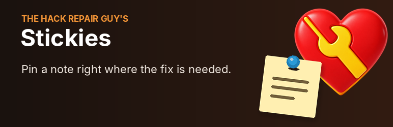
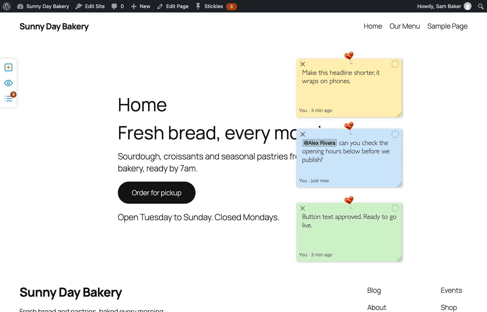
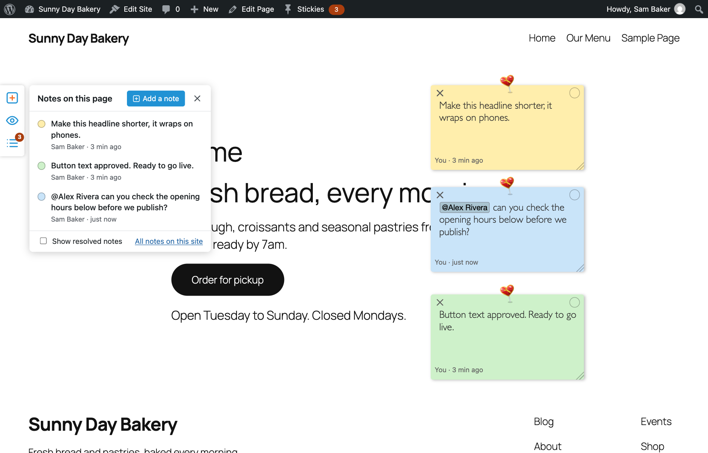
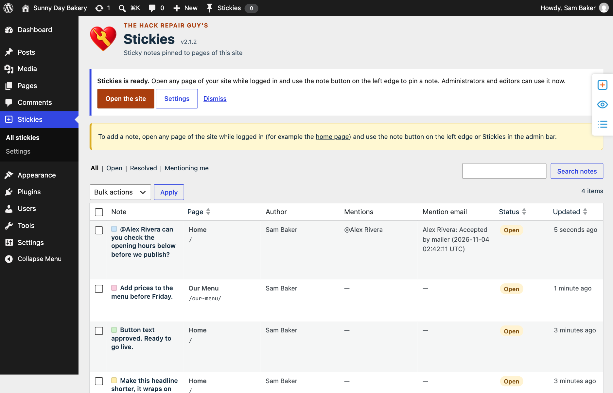
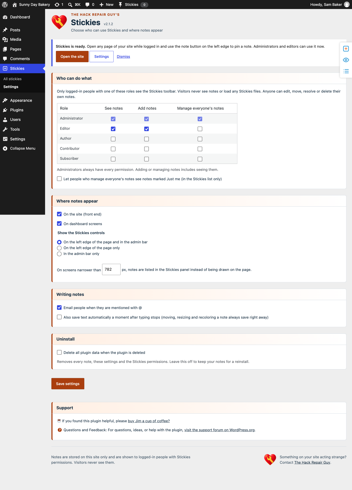

  

<h1 align="center">The Hack Repair Guy's Stickies</h1>

  
  
  
  
  

Pin sticky notes to the exact spot on any page of your WordPress site, mention a teammate, and mark the note resolved when the fix is done.

"The button on the contact page is the wrong color." "Client wants this paragraph shorter." "The plugin conflict shows up right here." Stickies lets your team say it right where it happens. Notes are only for logged-in people with Stickies access; visitors never see them.

  <strong>▶ Watch Stickies in action</strong> 
  
    
  <a href="https://wordpress.org/plugins/thrg-stickies/" title="Stickies on WordPress.org">Stickies on WordPress.org</a> · <a href="https://hackrepair.github.io/thrg-stickies/" title="The Stickies project page">Visit the Stickies page</a>

> **WordPress.org edition.** This branch is the build prepared for the WordPress.org plugin directory. It has no GitHub updater and no bundled update library; updates come from WordPress.org. The GitHub release edition, with its own updater, lives on the `main` branch.

## What it does

- A small toolbar on the left edge of every page (and a Stickies item in the admin bar) adds a note, hides or shows notes, and opens the list of notes on the page.
- Notes are paper-yellow by default, with blue, green, pink and gray as options. Pick a color from the button at the top right. Drag by the top edge or by the pin, resize from the corner, and pick a color: these save the moment you let go. Save text with the check button or Ctrl+S / Cmd+S. A Hack Repair heart pin shows a saved note.
- Type `@` to mention a teammate. They get an email linking straight to the note.
- Choose Team, Mentioned only, or Just me visibility. Mentioned only includes the author, mentioned people and note managers. Just me is author-only on the page; managers can also see it in the dashboard list if that setting is enabled. The ? beside the menu explains these rules.
- Mark a note resolved with the round check button. It leaves the page, with an Undo message, and stays in the notes panel (tick Show resolved) and the Stickies list, where it can be reopened.
- The first time Stickies is installed, a welcome note appears on your home page. It is marked Just me, so only you see it, and you can resolve or delete it like any other note.
- **Stickies** in the dashboard menu lists every note on the site with filters, search, and bulk resolve, reopen and delete.
- **Stickies > Settings** sets which roles can see, add or manage notes, whether people who manage everyone's notes can see Just me notes in the Stickies list, whether notes show on the site and on dashboard screens, where the controls appear, the screen width below which notes are listed in the panel instead of drawn on the page, mention emails, autosave and uninstall cleanup.

## Screenshots

   
  Notes pinned to a page. Drag and resize them, pick a color, and mention a teammate with @.

   
  The notes panel lists every note on the page.

   
  The Stickies list shows every note on the site, with filters, search and bulk actions.

   
  Settings choose who can see, add and manage notes, and where they appear.

## Privacy and scope

Notes live in one table in your site's database. They are fetched after the page loads through the WordPress REST API, so page caches never contain them. Nothing loads for visitors. Mention emails leave the site through your normal WordPress mail setup, and mention suggestions may load avatars from Gravatar or your configured avatar provider. The plugin is not a public comment system and has no anonymous notes.

## Install

1. In WordPress, open Plugins > Add New and search for "The Hack Repair Guy's Stickies" (once it is listed on WordPress.org), then choose Install Now.
2. Activate it, open any page of your site while logged in, and click the note button on the left edge.

Updates arrive through the normal WordPress Plugins screen from WordPress.org.

## Frequently asked questions

### Why does my mention show “No recorded send”?

Mentioning your own logged-in account does not send you an email. This is intentional, including on Team notes with mention emails enabled. Use a different administrator or editor to test.

The label means there is no saved send result. It also covers older mentions from before 2.0.1 and skipped notifications: emails disabled, invalid recipient/email, recipient unable to see the note, or the 10-minute cooldown.

### Does saving or resolving a note resend emails?

No. Only newly added mentions trigger notification attempts. Re-saving the same mention, resolving, or reopening a note does not resend it.

### How do I test it?

Enable mention emails, create a new Team note, select another administrator or editor from the @ dropdown, and save. Refresh the notes list for the send result and check Mailpit if used locally. If the new email arrives but no result is recorded, investigate the database upgrade and status write.

### Why is an editor missing from mentions or unable to see Stickies?

Role-editing tools or migrations can remove WordPress’s stored Stickies capabilities while the saved Editor settings remain checked. Starting with 2.0.4, Stickies reconciles its role capabilities with the saved permission matrix on each request, writing only when they differ. Individual user restrictions are preserved. Stickies settings are the source of truth: if a role editor grants or removes Stickies access for a role directly, the next page load changes it back to match Stickies > Settings. Change Stickies access in Stickies > Settings, not in a role editor. If you type a name in the @ list and the person is missing because their role cannot see notes yet, administrators see a short note saying so (with the account email and role) and a link to Stickies > Settings. Other users see no such note.

### How can I tell two people with the same name apart?

Administrators who can list users see email addresses next to names and can search by email. Other Stickies users see account IDs. Only eligible users appear, and selecting a mention stores the account ID, so matching names remain separate people.

## Author and support

**[Jim Walker](https://hackrepair.com/ "The Hack Repair Guy: WordPress security and hack repair")**, The Hack Repair Guy, author and maintainer.

[Support forum on WordPress.org](https://wordpress.org/support/plugin/thrg-stickies/ "Stickies support forum on WordPress.org") · [Report a bug](https://github.com/hackrepair/thrg-stickies/issues "GitHub Issues") · [Security reporting](mailto:jim%40hackrepair%2Ecom "Email Jim privately") · [Buy Jim a coffee](https://hackrepair.com/donations/buy-jim-a-coffee "Support The Hack Repair Guy")

## License and credits

[GPLv2 or later](https://www.gnu.org/licenses/gpl-2.0.html "Read the GNU General Public License, version 2").

Inspired by the 2014 WP Sticky Notes plugin by Soso Kruashvili (GPLv2). Stickies is a new plugin written from scratch; no code, images or text from it are used.

Made by [The Hack Repair Guy](https://hackrepair.com/ "The Hack Repair Guy: WordPress security and hack repair").

## Changelog

### 2.1.5

- Prepare database identifiers explicitly and keep administrator mention hints bounded.

### 2.1.4

- Recheck note visibility before returning a save response. If another edit makes the note private, its contents are withheld from anyone who lost access.

- Clarify all three visibility choices and note-manager access in the help tooltip.

See the **Changelog** section of [`readme.txt`](readme.txt).
